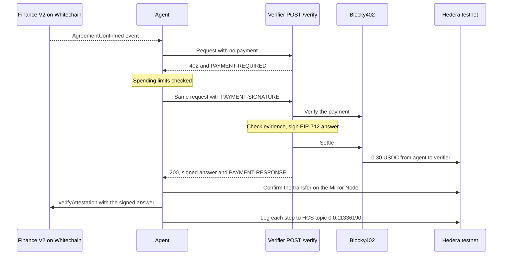
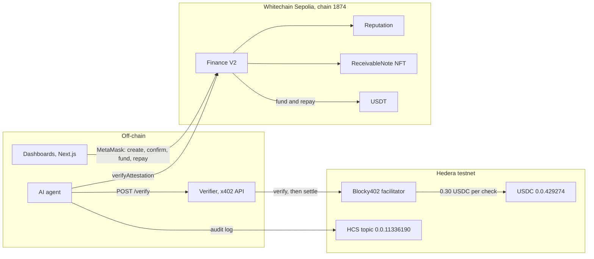

# TrustMeBro

Trade finance where an AI agent pays for shipment checks over x402 on Hedera, and a contract on Whitechain decides what gets funded.

An exporter needs cash now, but the importer pays in 60 days. An investor advances the money, and the importer repays the contract at the due date. Before any money moves, an agent buys an independent shipment check with no human approving it.

| Looking for                                | Section                                                                           |
| ------------------------------------------ | --------------------------------------------------------------------------------- |
| How to set it up                           | [Setup](#setup)                                                                   |
| How the parts fit together                 | [Architecture](#architecture)                                                     |
| The x402 payment flow                      | [x402 payment flow](#x402-payment-flow)                                           |
| Hedera transaction IDs of settled payments | [Settled payments on Hedera testnet](#settled-payments-on-hedera-testnet)         |
| Why settlement is onchain, in USDT         | [Why this settles in USDT on Whitechain](#why-this-settles-in-usdt-on-whitechain) |
| Current limitations                        | [Current limitations](#current-limitations)                                       |

**Demo video (2 to 4 minutes):** [VIDEO_LINK]. It shows the exporter, importer, investor, admin and agent, a payment settling, and its HashScan page.

## Qualification checklist

| Track      | Requirement                                                          | Where                                                                                                                                                                                                                                         |
| ---------- | -------------------------------------------------------------------- | --------------------------------------------------------------------------------------------------------------------------------------------------------------------------------------------------------------------------------------------- |
| Whitechain | Contracts on chain 1874, verified on the explorer                    | [Finance V2](https://explorer.testnet.whitechain.io/address/0x71e3c6aE367A0D8517A0DA7cC480cBa9e954DfC7?tab=contract), [Reputation](https://explorer.testnet.whitechain.io/address/0xdeDa59a4Fe774A0F553e9fBEa78D4bd96f0c2673?tab=contract), [ReceivableNote](https://explorer.testnet.whitechain.io/address/0x7a403A382fc3AFbe985ba1a00bA973674167BAD0?tab=contract) |
| Whitechain | USDT `0xcedf…55a7` payment in the main flow, with explorer link       | [Trade 7 fund](https://explorer.testnet.whitechain.io/tx/0x4c32e55904d778c978ff2f0a5e07f0fb872f5d291129b718c2f3b6b0f5dab1c7) and [repay](https://explorer.testnet.whitechain.io/tx/0x3874f4dc10e44c5f09d15f9ae57c7f307cd3bbc79e28b5d25525666ad1ebbfb4) |
| Whitechain | Why onchain stablecoin settlement                                    | [Why this settles in USDT on Whitechain](#why-this-settles-in-usdt-on-whitechain)                                                                                                                                                            |
| Whitechain | Setup, architecture, limitations                                     | [Setup](#setup), [Architecture](#architecture), [Current limitations](#current-limitations)                                                                                                                                                  |
| Whitechain | Feedback file                                                        | [`WHITECHAIN_FEEDBACK.md`](WHITECHAIN_FEEDBACK.md)                                                                                                                                                                                           |
| Hedera     | x402 endpoint settling on Hedera testnet via Blocky402               | [x402 payment flow](#x402-payment-flow)                                                                                                                                                                                                       |
| Hedera     | Agent pays end to end with no human approving                        | Trade 7, [`0.0.7162784@1794010184.118241140`](https://hashscan.io/testnet/transaction/0.0.7162784@1794010184.118241140)                                                                                                                      |
| Hedera     | Hedera transaction ID of a settled payment                           | [Settled payments on Hedera testnet](#settled-payments-on-hedera-testnet)                                                                                                                                                                    |
| Hedera     | Extra: spending controls and allowlist                               | Per-call, per-deal and daily budgets, merchant allowlist, checks per exporter, human approval above the limit                                                                                                                                 |
| Hedera     | Extra: HCS topic as a tamper-evident audit log                       | [`0.0.11336190`](https://hashscan.io/testnet/topic/0.0.11336190), hash-chained messages                                                                                                                                                       |
| Hedera     | Extra: settles in an HTS token                                       | USDC `0.0.429274`                                                                                                                                                                                                                             |

## x402 payment flow

1. The exporter creates an invoice, and the importer confirms it on Whitechain.
2. The agent sees the confirmed trade and calls the verifier's `POST /verify`, which answers `402 Payment Required`.
3. The agent checks its spending limits: network, token, merchant allowlist, per-call, per-deal and daily budgets, and checks per exporter.
4. It pays 0.30 USDC on Hedera testnet through the Blocky402 facilitator, then retries with payment.
5. The verifier checks the evidence and signs an EIP-712 answer.
6. The agent confirms the payment on the Mirror Node, then relays the answer to Finance V2 from a wallet with no roles.
7. The contract checks the signer, terms, nonce and expiry, then marks the deal Verified so an investor can fund it.
8. Every step is logged to HCS topic `0.0.11336190`.



What the verifier's 402 asks for:

| Field       | Value                                          |
| ----------- | ---------------------------------------------- |
| Scheme      | `exact`                                        |
| Network     | `hedera:testnet`                               |
| Asset       | USDC `0.0.429274`, 6 decimals                  |
| Amount      | `300000`, which is 0.30 USDC                   |
| Pay to      | `0.0.11331478`, the verifier's account         |
| Facilitator | Blocky402, `https://api.testnet.blocky402.com` |
| Timeout     | 120 seconds                                    |

The agent is only charged when the verifier answers `200`. A `4xx` answer costs nothing. A `200` can still be `insufficient_evidence` with no signature, because paying for a check doesn't buy a pass.

### Settled payments on Hedera testnet

Trade 7 was checked with no human approving the payment:

| What             | Reference                                                                                                                                                                            |
| ---------------- | ------------------------------------------------------------------------------------------------------------------------------------------------------------------------------------ |
| Trade            | 7, importer Trust Score 76                                                                                                                                                           |
| Hedera payment   | [`0.0.7162784@1794010184.118241140`](https://hashscan.io/testnet/transaction/0.0.7162784@1794010184.118241140)                                                                       |
| Whitechain relay | [`0x33c2b9a50723dc8ac28ca56b994bb39327e42be94c7c6a641b2db247d52d0985`](https://explorer.testnet.whitechain.io/tx/0x33c2b9a50723dc8ac28ca56b994bb39327e42be94c7c6a641b2db247d52d0985) |
| Audit topic      | [`0.0.11336190`](https://hashscan.io/testnet/topic/0.0.11336190)                                                                                                                     |

Between 06:02 IST on 6 Nov and 05:39 IST on 7 Nov 2026, the agent settled 54 payments of 0.30 USDC, 16.20 USDC in total, from its account `0.0.11331527` to the verifier's `0.0.11331478`. A few of them:

| When (IST)      | Hedera transaction ID                                                                                          | Note                                         |
| --------------- | -------------------------------------------------------------------------------------------------------------- | -------------------------------------------- |
| 6 Nov, 06:02:44 | [`0.0.7162784@1793925155.766911541`](https://hashscan.io/testnet/transaction/0.0.7162784@1793925155.766911541) | First payment of the event                   |
| 6 Nov, 11:16:44 | [`0.0.7162784@1793943996.436285753`](https://hashscan.io/testnet/transaction/0.0.7162784@1793943996.436285753) | Blocky402 paid a 0.016 HBAR network fee      |
| 7 Nov, 00:29:27 | [`0.0.7162784@1793991560.801698510`](https://hashscan.io/testnet/transaction/0.0.7162784@1793991560.801698510) | Check for trade 3, logged on the audit topic |
| 7 Nov, 05:39:56 | [`0.0.7162784@1794010184.118241140`](https://hashscan.io/testnet/transaction/0.0.7162784@1794010184.118241140) | Check for trade 7, relayed to Whitechain     |

Every ID starts with `0.0.7162784` because Blocky402 submits the transfer and pays its HBAR fee. The USDC itself moves from `0.0.11331527` to `0.0.11331478`, and HashScan shows both sides under token `0.0.429274`. This [Mirror Node query](https://testnet.mirrornode.hedera.com/api/v1/transactions?account.id=0.0.11331527&transactiontype=CRYPTOTRANSFER&timestamp=gte:1793836800&limit=100) lists all of them.

[](https://hashscan.io/testnet/transaction/0.0.7162784@1793943996.436285753)

The 11:16:44 IST payment on HashScan. Click the image to open the live page.

**The shipment evidence is simulated.** The payment, signature, relay and contract rules are real testnet activity. No shipping data provider is connected, so the verifier generates evidence labelled `DEMO_SIMULATION`, which always matches the invoice. A real provider plugs in through `SHIPPING_PROVIDER_MODULE`.

## Why this settles in USDT on Whitechain

The investor's USDT can only move after a signed shipment check passes, and the importer's repayment has to be split between the investor, the platform and the exporter in a fixed order. Finance V2 does both on Whitechain, each in a single transaction, so nobody holds the money in between and nobody, including us, decides who gets paid. A bank transfer can't wait for a signature check before it releases money, can't split one payment three ways in a set order, and can't update the importer's reputation in the same step.

| Need                               | Finance V2 on Whitechain                                                                                       | Bank transfer                                                       |
| ---------------------------------- | -------------------------------------------------------------------------------------------------------------- | ------------------------------------------------------------------- |
| Release money only after the check | `fund()` reverts until `verifyAttestation` accepts an EIP-712 answer signed by a `VERIFIER_ROLE` key           | Someone reads the check and decides to send the wire                |
| Repayment order                    | `repay()` pays the investor, the 1% fee and the exporter in one transaction                                    | Three transfers, and whoever gets the money first has to pass it on |
| Terms can't change                 | `fund()` takes the hash of the quote the investor saw, the treasury and a deadline, and reverts if any changed | The amount can change between the offer and the payment             |
| Reputation                         | The importer's score moves in the same transaction as the repayment                                            | A separate record that someone updates and everyone has to trust    |
| Proof                              | Every step is public on the Whitechain explorer                                                                | Statements that only the account holders can see                    |

We use USDT rather than WBT because the invoice is in dollars, and a 60-day deal needs a unit that holds its value against the invoice. The exporter, the importer and the investor hold the same token on the same chain, so there's no currency conversion between India, Dubai and wherever the investor is.

### Trade 7 on the live chain

Times are IST on 7 Nov 2026.

| Step                                                    | Time     | Transaction                                                                                                                   | What happened                                                                                            |
| ------------------------------------------------------- | -------- | ----------------------------------------------------------------------------------------------------------------------------- | -------------------------------------------------------------------------------------------------------- |
| Exporter creates the invoice                            | 05:38:50 | [`0x6e10…c6dd`](https://explorer.testnet.whitechain.io/tx/0x6e10457325f4ba51a69c3eecccf11f1eb0a1e869b5c2e8f1a62d6020e92fc6dd) | 1.00 USDT face value, invoice hash stored                                                                |
| Importer confirms                                       | 05:39:34 | [`0xae4d…c5ec`](https://explorer.testnet.whitechain.io/tx/0xae4d8d2916e9966e62dfd478559263de2a742306c44abf6d2a6fdebfddf3c5ec) | The importer agrees to pay the contract                                                                  |
| Agent relays the paid check from a wallet with no roles | 05:40:12 | [`0x33c2…0985`](https://explorer.testnet.whitechain.io/tx/0x33c2b9a50723dc8ac28ca56b994bb39327e42be94c7c6a641b2db247d52d0985) | `ShipmentChecked` with mode `TRUSTED_SERVICE_ATTESTATION`                                                |
| Investor funds                                          | 06:08:30 | [`0x4c32…b1c7`](https://explorer.testnet.whitechain.io/tx/0x4c32e55904d778c978ff2f0a5e07f0fb872f5d291129b718c2f3b6b0f5dab1c7) | 0.7372 USDT straight to the exporter, receivable NFT #7 to the investor                                  |
| Importer repays                                         | 06:10:05 | [`0x3874…bfb4`](https://explorer.testnet.whitechain.io/tx/0x3874f4dc10e44c5f09d15f9ae57c7f307cd3bbc79e28b5d25525666ad1ebbfb4) | 1.00 USDT in, then 0.759316 to the investor, 0.01 fee, 0.230684 to the exporter. Importer score 76 to 80 |

The check behind the relay was paid on Hedera in [`0.0.7162784@1794010184.118241140`](https://hashscan.io/testnet/transaction/0.0.7162784@1794010184.118241140). From the importer's confirmation to a verified deal took 38 seconds, Hedera payment included. The five Finance V2 calls used 1,050,240 gas, about 0.0053 WBT at the 5 gwei base fee. The two USDT approvals are on top of that.

Trades 1 and 2 were checked by the admin with `verifyManual` before the agent was connected. Trade 7 is the first one checked by the agent.

## Architecture



| Part                                             | Path                                     | Runs on           |
| ------------------------------------------------ | ---------------------------------------- | ----------------- |
| Dashboards and landing page                      | `src/`                                   | Next.js           |
| AI agent, x402 payer, spending limits, audit log | `Hedera_Agentic_Payments/services/agent` | Long-running Node |
| x402 verifier                                    | `services/verifier`                      | Long-running Node |
| Shared ABIs and rules                            | `packages/shared`                        | Library           |
| Finance V2, Reputation, ReceivableNote           | Deployed on Whitechain Sepolia           | Chain 1874        |

| Contract            | Address                                      |
| ------------------- | -------------------------------------------- |
| Finance V2          | `0x71e3c6aE367A0D8517A0DA7cC480cBa9e954DfC7` |
| Importer reputation | `0xdeDa59a4Fe774A0F553e9fBEa78D4bd96f0c2673` |
| ReceivableNote      | `0x7a403A382fc3AFbe985ba1a00bA973674167BAD0` |
| Test USDT           | `0xcedfB56113143d55b2358b8CFbB0dEB5Ad2f55a7` |

Flow charts are in `docs/diagrams`, and the product spec is `docs/PRD.md`. Parts of the charts and the PRD's sections 6 to 9 describe the original plan. Its "Live contract update" section lists where the deployed contract differs.

## How a deal is priced

The importer's Trust Score comes from the Reputation contract. New importers start at 60, and it's capped at 93.

```
Base           = floor(Invoice × 97%)
Advance        = floor(Base × Trust Score ÷ 100)
InvestorProfit = floor(Advance × 3%)
PlatformFee    = floor(Invoice × 1%)
ExporterFinal  = Invoice − Advance − InvestorProfit − PlatformFee
```

## Setup

You need:

- Node 24 (the root `package.json` pins `24.x`; the Next.js build failed for us on Node 20 and 22.12), and pnpm 10.7 for `Hedera_Agentic_Payments`. `npx pnpm@10.7.0` works without installing it.
- MetaMask on Whitechain Sepolia (chain 1874, RPC `https://rpc.testnet.whitechain.io`), with WBT from the [faucet](https://faucet.testnet.whitechain.io/) for gas, and test USDT `0xcedfB56113143d55b2358b8CFbB0dEB5Ad2f55a7`, which you get by swapping WBT on YetiTrade.
- Two Hedera testnet ECDSA accounts from [portal.hedera.com](https://portal.hedera.com/): one for the agent, which pays, and one for the verifier, which gets paid. Both must be associated with USDC `0.0.429274` (`pnpm associate-usdc` in `Hedera_Agentic_Payments` does the verifier's), and the agent's account needs test USDC from [faucet.circle.com](https://faucet.circle.com/).
- An EVM key for the verifier to sign answers with, which the admin grants `VERIFIER_ROLE` on Finance V2, and a relayer EVM key with no roles and a little WBT.

### 1. Dashboard

```bash
npm install
npm run dev
```

Then open [http://localhost:3000](http://localhost:3000). The dashboards read Finance V2 live on Whitechain Sepolia, and every action is signed in MetaMask. The server holds no keys. Connecting a wallet opens the dashboard for its role on Finance V2. The admin adds and removes parties on the Parties page.

| Variable                               | What it does                                                                                                        |
| -------------------------------------- | ------------------------------------------------------------------------------------------------------------------- |
| `WHITECHAIN_RPC`                       | RPC URL. Defaults to the public one                                                                                 |
| `KV_REST_API_URL`, `KV_REST_API_TOKEN` | Redis for a hosted dashboard. Without them, trade details go to `Hedera_Agentic_Payments/services/agent/.state/v2/` |
| `AGENT_SYNC_TOKEN`                     | Shared secret that lets the agent read new trades from `/api/agent`                                                 |
| `PARTY_NAMES`                          | Names shown for existing wallets, as JSON                                                                           |

The demo uses these wallets:

| Role     | Wallet                                       |
| -------- | -------------------------------------------- |
| Exporter | `0x4DCdA2a3b4b8c8aC71d3e9224e5a80FBF9a4219C` |
| Importer | `0xEd450f58f5287d37Ca9200930F14EbcaFa44CFF4` |
| Investor | `0x0dfd32c23580B576bCfEFcd418861162F4053873` |
| Admin    | `0xB758E119133050305520E2F47362cfDd9E55A325` |

### 2. Verifier

```bash
cd packages/shared && npm ci --ignore-scripts
cd ../../services/verifier && npm ci --ignore-scripts
cp v2.env.example .env
```

Fill in `SERVICE_SIGNER_PRIVATE_KEY`, `VERIFIER_ADDRESS` (that key's public address) and `VERIFIER_PAYTO` (the Hedera account that receives USDC). The rest of `v2.env.example` already holds the testnet values: USDC `0.0.429274`, Blocky402 and a price of `$0.30`. Instead of editing by hand, `npm run setup:v2-demo -- "--credentials=PATH"` writes this file and the agent's from one credentials file. `npm run diagnose:v2` checks the config without starting anything.

### 3. Agent

```bash
cd Hedera_Agentic_Payments
npx pnpm@10.7.0 install --frozen-lockfile
cd services/agent
cp v2.env.example .env
```

Fill in `AGENT_HEDERA_ACCOUNT_ID` and `AGENT_HEDERA_PRIVATE_KEY` for the paying account, `VERIFIER_PAYTO`, `VERIFIER_ADDRESS` and `RELAYER_PRIVATE_KEY`. The agent also reads `Hedera_Agentic_Payments/.env`, and its `.env.example` lists the spending limits (`POLICY_*`: 1.00 USDC per call and per deal, 10.00 a day, 3 checks per deal, 5 per exporter a day) and the audit log settings (`AUDIT_OPERATOR_ID`, `AUDIT_OPERATOR_KEY`, `AUDIT_TOPIC_ID`). `pnpm --filter @tmb/audit create-topic` creates a new HCS topic. For a hosted dashboard, also set `DASHBOARD_URL` and the same `AGENT_SYNC_TOKEN`.

`npm run start:v2 -- --read-only --once` finds confirmed trades without paying for anything.

### 4. Run the automatic check

```bash
# services/verifier
DEMO_EVIDENCE_AUTO=I_UNDERSTAND_SHIPMENT_EVIDENCE_IS_SIMULATED \
V2_DEMO_ACK=I_UNDERSTAND_SHIPMENT_EVIDENCE_IS_SIMULATED npm run start:v2

# Hedera_Agentic_Payments/services/agent
V2_EXECUTE=I_AUTHORIZE_LIVE_HEDERA_PAYMENTS_AND_WHITECHAIN_RELAYS \
V2_DEMO_ACK=I_UNDERSTAND_SHIPMENT_EVIDENCE_IS_SIMULATED npm run start:v2
```

Once running, the agent spends 0.30 USDC on every newly confirmed trade, within its limits, until you stop it.

### How a trade gets checked

A trade's check comes from one of three places:

- **Automatic paid check:** step 4 above.
- **One-off paid check:** follow `V2_METAMASK_DEMO.md`. For a trade made in the dashboard, run `npm run demo-evidence -- --trade-id=ID` just before the check. The agent's signed answer appears on the admin deal page, ready to relay from MetaMask.
- **Manual check:** the admin records it from the same page, with no x402 payment. This is what trades 1 and 2 used.

### Tests

```bash
cd services/verifier && npm test && npm run test:v2
cd Hedera_Agentic_Payments && npx pnpm@10.7.0 run test:unit
```

Two tests load the Finance V2 Hardhat package, which isn't in this repo: `services/verifier/test/metamask.test.ts` and the agent's `test/v2-evm.test.ts` (set `V2_PACKAGE_PATH` for it). They fail without that package. The other tests don't need it.

## Current limitations

- **Simulated shipment evidence.** No shipping data provider is connected. The verifier's evidence is labelled `DEMO_SIMULATION`. The payment, signature, relay and contract rules are real testnet activity.
- **One trusted verifier.** The verifier is the team's own attestor, with one signing key holding `VERIFIER_ROLE`.
- **Default risk sits with the investor.** If an importer doesn't repay, the investor carries the loss.
- **KYC is an admin allowlist.** Related companies could still collude.
- **Manual top-ups.** The agent's Hedera USDC and the relayer's WBT are topped up by hand.
- **Testnet only.** Running this with real money needs a regulated entity, real KYC and licensed on- and off-ramps.
- **Soft confirmations.** The agent waits 2 blocks, which is fine on testnet but too few for real money.
- **Two tests need an outside package.** They depend on the Finance V2 Hardhat package (see [Tests](#tests)).

## Use of AI tools

This project used Claude Code (Anthropic) as a development assistant. The team set the product, the trade finance design and the decisions on what to build, reviewed the results, and ran the live testnet deals.

| Area                                          | How AI was used                                                                      |
| --------------------------------------------- | ------------------------------------------------------------------------------------ |
| `src/` landing page and dashboards            | Generated with Claude Code from the team's direction, then adjusted through review   |
| `src/lib/chain`, `src/lib/trade`, role access | Written with Claude Code to connect the dashboards to the team's contracts and agent |
| `services/verifier`                           | Claude Code added per-trade demo evidence and its tests                              |
| `Hedera_Agentic_Payments/services/agent`      | Claude Code added Mirror Node retries, trade reloading and the heartbeat             |
| `docs/PRD.md`, `docs/diagrams`                | Drafted with Claude Code from the team's plan                                        |

The planning documents are in `docs/`. Project skills are in `.claude/skills`. No LLM makes any money decision in the product: spending limits, evidence checks and contract rules are fixed code.

## Scripts

| Command             | What it does         |
| ------------------- | -------------------- |
| `npm run dev`       | Start the dev server |
| `npm run build`     | Build for production |
| `npm run start`     | Serve the build      |
| `npm run lint`      | Run ESLint           |
| `npm run typecheck` | Check types          |
| `npm run format`    | Format with Prettier |

## Project layout

- `src/app`: routes, root layout and theme tokens (`globals.css`)
- `src/components/ui`: shadcn components, which you own and can edit
- `.claude/skills`: Claude Code skills for this project

## Claude Code skills

`.claude/skills` holds the Apache-2.0 skills from [anthropics/skills](https://github.com/anthropics/skills) and the MIT-licensed `shadcn` skill from [shadcn-ui/ui](https://github.com/shadcn-ui/ui). Each skill keeps its own license file.

The `docx`, `pdf`, `pptx` and `xlsx` skills are proprietary and can't be copied into a repository. To install them, run this in Claude Code:

```
/plugin marketplace add anthropics/skills
/plugin install document-skills@anthropic-agent-skills
```
