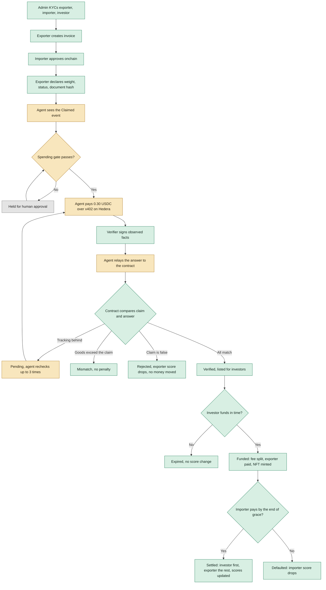
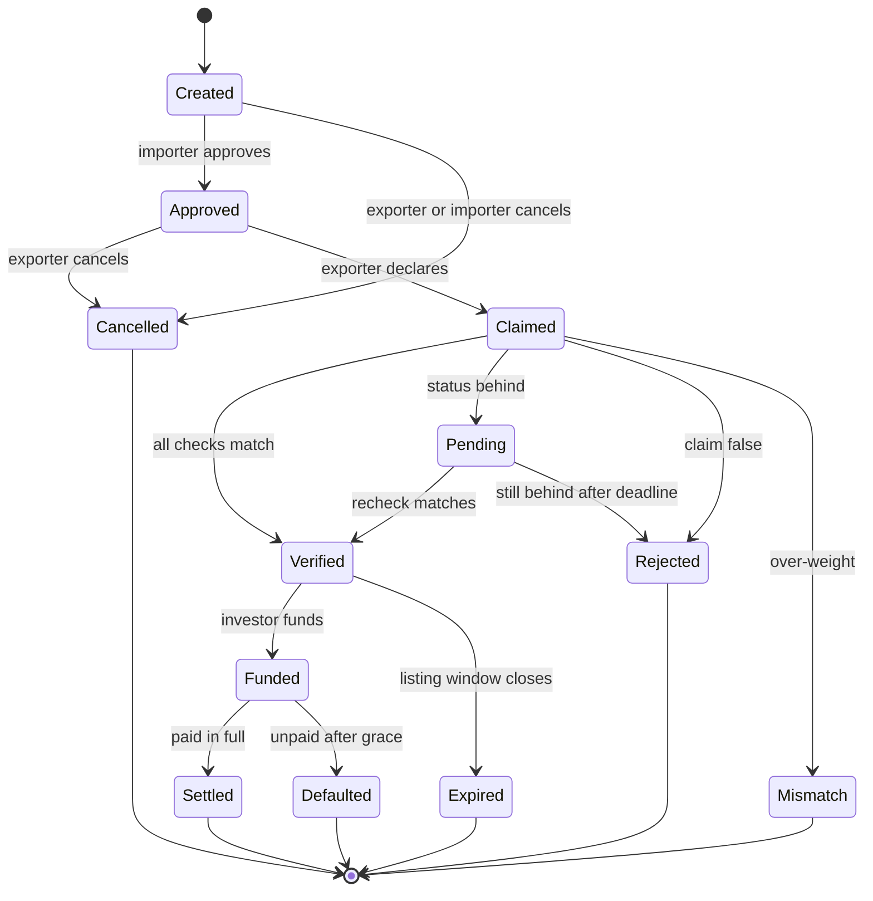
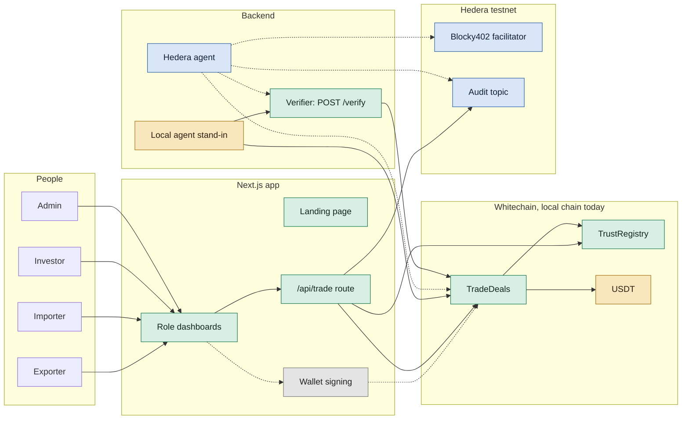
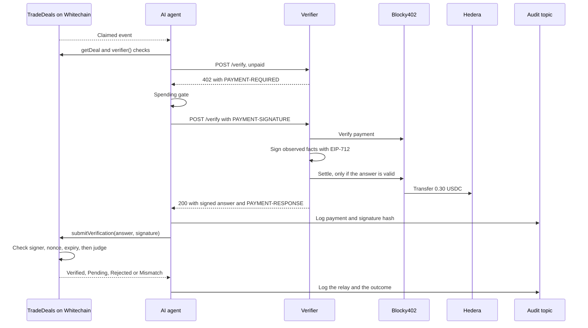

# TrustMeBro Product Requirements

Version 2.0, Saturday 7 November 2026. Built for ETHGlobal Mumbai 2026: Whitechain "Tokenize, Real World Finance" and Hedera "AI Agents That Pay: x402". Source of rules: plan v5, `ref_docs/TrustMeBro_v5_Complete_Plan.md`.

**Slide-ready diagrams:** `docs/diagrams/` holds interactive HTML and PNG versions of all four charts, made with Archify.

**Status words used in this document**

- **Done**: built and tested in this repository.
- **Stand-in**: works end to end, using a local substitute for the real thing.
- **Partly**: some of it works, and the rest is listed beside it.
- **Not yet**: not built.

## 1. Summary

**One line:** investors replace the bank, and honesty sets the price.

**For judges:** your shipment claims are your collateral. An AI agent pays to check them, the contract decides if they're true, and your Trust Score remembers.

A small exporter ships goods and waits 60 days to be paid. TrustMeBro lets one investor fund that invoice in USDT within minutes. First, an AI agent pays an independent verifier 0.30 USDC on Hedera to check the shipment. The smart contract on Whitechain then compares the signed answer with the exporter's claims. If they match, the deal can be funded. If the exporter lied, the deal is rejected before any investor money moves, and the lie stays on their score.

## Live contract update

The team deployed **Finance V2** on Whitechain at `0x71e3c6aE367A0D8517A0DA7cC480cBa9e954DfC7`. Where this document and the live contract differ, the contract is correct. Sections 6, 7, 8 and 9 describe the plan. These are the differences:

| Topic | Plan v5 | Live Finance V2 |
|---|---|---|
| Advance | Equals the exporter score | Invoice × deal score × 97% |
| Deal score | Exporter score | Follows the importer's reputation: 60, 70, then 76 |
| Investor return | 2% to 8%, set by importer risk | 3% of the advance on every live trade |
| Platform fee | 1% of the advance, at funding, split four ways | 1% of the invoice, at settlement, to the treasury |
| Failed check | Exporter score drops | No signature, so the deal can't be funded |
| Claims | Exporter declares after shipping | Committed in the invoice as hashes |
| Term | Set per deal | 60 days, plus 7 days' grace |
| Importer starting trust | Set by the admin | No such function. Everyone starts at the contract's default |
| Access | Each wallet holds one role | The dashboard enforces this. The contract would allow two roles on one wallet |

Live example from the fork test, invoice 10 USDT at deal score 76: advance 7.372, investor gets back 7.59316, fee 0.10, exporter gets 2.30684 at settlement.

The dashboard shows one score: the importer's Trust Score, which is the contract's Reputation score. New importers start at 60, and the score is capped at 93. Exporters have no score. Advance = floor(floor(invoice × 97%) × Trust Score ÷ 100). Investor profit = floor(advance × 3%). Platform fee = floor(invoice × 1%). The exporter gets the rest at settlement.

## 2. Problem

- Exporters wait about 60 days for importers to pay, and they need cash to fulfil the next order.
- Banks find small deals too slow and too costly. The plan cites a trade finance gap of about US$2.5 trillion for small exporters (Asian Development Bank).
- A lender can't easily tell whether a shipment is real. Documents are often wrong, and claims are hard to check.
- Reputation doesn't travel. An honest small exporter has no portable record that lowers their cost of money.

## 3. Solution

1. Turn the invoice into a deal onchain, so it can never be financed twice.
2. Make the exporter commit real values: weight in kg, shipment status and a document hash.
3. Have an agent buy independent evidence, with no human and within hard spending limits.
4. Let the contract judge the evidence, so no AI decides who gets paid.
5. Price the deal from reputation: the exporter's Trust Score sets the advance, and the importer's Risk Score sets the yield.

**How it differs from similar projects:** the closest prior work, Facture, uses invoice bonds with x402 as settlement. TrustMeBro checks the shipment itself before money moves, has an agent buy the evidence, and keeps an onchain reputation that prices each deal.

## 4. Users

| Actor | Example | What they want | What they do | Chain |
|---|---|---|---|---|
| Exporter | Ravi Exports | Cash now, not in 60 days | Creates the invoice, declares claims, receives the advance and the rest | Whitechain |
| Importer | Ahmed Imports | Normal payment terms | Approves the invoice, pays the contract on the due date | Whitechain |
| Investor | Priya Capital | Yield tied to real trade | Reviews evidence and scores, funds the deal, holds the receivable NFT | Whitechain |
| x402 verifier | `POST /verify` | Paid per check | Returns observed facts, signed with EIP-712 | Hedera payment |
| AI agent | TypeScript service | Stay inside its limits | Watches claims, pays for checks, relays answers, logs everything | Hedera and Whitechain |
| Admin | The team | Keep the allowlist clean | Runs KYC and adds or removes parties. Cannot change scores | Whitechain |

## 5. Goals and non-goals

**Goals**

- Qualify for both prize tracks: Hedera ($6,500 pool) and Whitechain ($4,000 pool).
- Show a full deal on screen, from invoice to settlement, with real transactions.
- Show that lying is caught, costs the liar, and moves no investor money.

**Non-goals**

- Checking product quality. The importer makes no quality claim.
- Real carrier or weighbridge feeds. The verifier's data is simulated and labelled as simulated.
- An LLM on the money path. The agent follows fixed rules and never judges.
- Fractional investing. Each deal has one investor.

## 6. End-to-end flow

Colours show how real each step is today. Green is real and tested, amber is a local stand-in, and grey is not built yet.

**In words**

1. **KYC.** Admin adds each wallet on the Parties page, which grants its role onchain. One KYC is one address and one role, and that role decides the one dashboard the wallet can open.
2. **Create.** The exporter creates the invoice. The contract stores its hash and checks the credit limit and the 40% score floor.
3. **Approve.** The importer accepts the debt and agrees to pay the contract.
4. **Claim.** After shipping, the exporter commits the weight, status and document hash.
5. **Check.** The agent clears its spending gate, pays 0.30 USDC on Hedera, and receives signed facts.
6. **Decide.** The contract returns Verified, Pending, Rejected or Mismatch.
7. **Fund.** One investor reviews the evidence and pays the advance. The fee split and the exporter's payment happen in that one transaction.
8. **Settle.** The importer pays. The investor is paid first, and the exporter gets the rest. Both scores rise.

## 7. Deal states

## 8. Product rules

### 8.1 The three checks

| Check | Exporter claims | Verifier observes | Rule | Weight |
|---|---|---|---|---|
| Weight | Declared kg | Terminal weighbridge reading | Within 3% matches. More than 3% under is falsified. More than 3% over is a mismatch with no penalty | 40% |
| Documents | Document hash | Hash of the carrier's eBL bundle | Equal matches, different is falsified | 35% |
| Status | Loaded or later | Carrier tracking status | Reached matches. Behind is Pending. Still behind after the deadline is falsified | 25% |

### 8.2 Scores

Every score uses the Beta reputation formula: **Trust = (r + A) / (r + s + A + B)**, in basis points. Honest events only add to r, and lies only add to s. Admin has no function to set a score.

| Party | Score shown | Starts at | Better when | Effect |
|---|---|---|---|---|
| Exporter | Trust Score | 50% | Higher | Advance equals the score, capped at 90%. Below 40% they can't open deals |
| Importer | Risk Score | 4.00% | Lower | Risk = 2% + 6% × (1 − trust). It's the investor's yield per deal, from 2% to 8% |

| Exporter event | Trust Score |
|---|---|
| New exporter | 50.00% |
| 1, 2, 3, 5 settled deals | 66.67%, 75.00%, 80.00%, 85.71% |
| 8 settled deals | 90.00%, the cap |
| New exporter fakes weight | 26.32%, blocked |
| New exporter fakes documents | 27.03%, blocked |
| New exporter fakes status | 28.57%, blocked |
| 5 settled deals, then fakes weight | 68.18% |

**Who moves when**

- Exporter honest and importer pays: both improve.
- Exporter lies: only the exporter drops.
- Importer late or defaults: only the importer drops.
- Credit for honesty comes at settlement, so verified deals nobody funds can't pump a score.

**Credit limit:** 200 USDT + 2 × settled invoice value. This stops an exporter building a score on tiny deals and then cheating on a huge one.

### 8.3 Money

At funding, the investor pays advance = invoice × exporter score. The platform fee is 1% of the advance, with a 2 USDT minimum, and it's split in this order: 1 USDT to the agent wallet, 0.50 USDT for gas, 20% of the remainder to the reserve fund, and the rest as platform profit.

| Worked example | Plan example | Tested live |
|---|---|---|
| Invoice | 100,000 USDT | 100 USDT |
| Exporter score | 70% | 80% |
| Importer risk | 4.00% | 2.80% |
| Investor pays | 70,000 | 80 |
| Platform fee | 700 | 2 |
| Exporter receives now | 69,300 | 78 |
| Investor gets back | 72,800 | 82.24 |
| Exporter gets the rest | 27,200 | 17.76 |

### 8.4 Agent safety

- No LLM on the money path. The agent pays and relays, and the contract judges.
- Before each payment: payee allowlist, USDC only, Hedera testnet only.
- Limits: 1.00 USDC per call, 1.00 per deal (3 checks), 10.00 per day, 5 checks per exporter per day.
- Anything over a limit waits for a human to approve it.
- Bad requests are free, because payment settles only on a successful answer.
- Every quote, payment, refusal and relay goes to a hash-chained Hedera audit topic.

## 9. System architecture

Green is live in this app. Blue is real and proven by the team, but not connected to this app yet. Amber is a local stand-in. Grey is not built. Dashed lines are planned connections.

| Component | Location | Job | Status |
|---|---|---|---|
| Landing page | `src/app/(marketing)` | Explains the product | Done |
| Dashboards | `src/app/(dashboard)` | Exporter, importer, investor and admin views | Done |
| Trade API | `src/app/api/trade`, `src/lib/chain` | The only code that reads and writes contracts | Done |
| Contracts | `contracts/` | Deals, scores, money rules | Done |
| Verifier | `services/verifier` | Paid check, signed answers, demo scenarios | Done |
| Hedera agent | `Hedera_Agentic_Payments/services/agent` | Pays over x402 and relays | Partly |
| Audit | `Hedera_Agentic_Payments/services/audit` | Writes to the Hedera topic | Done |

## 10. The x402 payment

The agent never sends claims to the verifier. The claims are already onchain, so the agent can't launder a lie. The signature's domain uses Whitechain's chain ID 1874, so an answer can't be replayed elsewhere.

## 11. Feature requirements

| ID | Requirement | Role | Status |
|---|---|---|---|
| F1 | Create an invoice with a credit limit and terms preview | Exporter | Done |
| F2 | Declare value claims and pick a demo scenario | Exporter | Done |
| F3 | See the importer's Trust Score, advance and earnings on each deal | Exporter | Done |
| F4 | See earnings and the cost of finance | Exporter | Done |
| F5 | Approve invoices | Importer | Done |
| F6 | Pay in full or in part | Importer | Done |
| F7 | See Trust Score, how it sets payouts, and payment history | Importer | Done |
| F8 | Browse verified deals with both scores | Investor | Done |
| F9 | See evidence: claimed against observed | Investor | Done |
| F10 | Fund a deal and hold the receivable NFT | Investor | Done |
| F11 | See portfolio and returns | Investor | Done |
| F12 | See all deals, parties and the fee split | Admin | Done |
| F13 | See agent activity and live Hedera audit entries | Admin | Done |
| F14 | Approve or reject over-limit payments | Admin | Partly |
| F15 | Add and remove parties from the dashboard, onchain | Admin | Done |
| F16 | Sign actions in the user's own wallet | All | Done |
| F17 | Connect to deployed Whitechain contracts | All | Done |
| F18 | Real x402 payment inside this app's flow | Agent | Partly |
| F19 | Keep goods names and invoice references in durable storage | Platform | Stand-in |

## 12. What's real today

| Area | Today | Status | What's left |
|---|---|---|---|
| Contract | Finance V2 live on chain 1874 | Done | Verify the source on the explorer |
| USDT | Sponsor token `0xcedf...55a7` | Done | Nothing |
| Dashboards | Read live trades, roles, scores and balances | Done | Nothing |
| Signing | MetaMask in the browser, no keys on the server | Done | Tested on a fork, not yet on the live chain |
| Full deal | Create, confirm, verify, fund, repay | Done | Run it once on the live chain |
| Paid check | Agent and verifier built, one real payment made on trade 3 | Partly | Keys on this machine, plus approval to pay |
| Evidence | Simulated, labelled as simulated | Done | Real feeds are out of scope |
| Audit log | Real topic `0.0.11336190`, shown live | Done | Nothing |
| Goods names | Local file | Stand-in | A small database before hosting |

**Evidence so far**

- A forked copy of live Whitechain ran the whole deal through the real UI, with real contract bytecode. Every balance moved as quoted, and the importer's score rose from 76 to 80.
- Trades 1 and 2 settled on the live chain with real USDT, using manual verification.
- Real paid check: Hedera transaction `0.0.7162784@1793991560.801698510`, for trade 3.

## 13. Remaining work

| Order | Work | Owner | Blocks |
|---|---|---|---|
| 1 | Verify Finance V2, Reputation and the note on the explorer | Contract owner | Whitechain prize |
| 2 | Give the importer more USDT, or keep invoices under 11 USDT | Team | Repayment |
| 3 | Run one full deal live from MetaMask | Team | Proof links |
| 4 | Run a paid check end to end | Agent owner | Hedera prize video |
| 5 | Record every transaction in `PROOFS.md` | All | Submission |
| 6 | Finish `README`, `WHITECHAIN_FEEDBACK.md` and `AI_USAGE.md` | All | Submission |
| 7 | Rehearse, record a 2 to 4 minute video, and submit | All | Submission |

**After the hackathon**

- Investor claims on a reserve fund after a default.
- Real data feeds: carrier tracking, terminal weighbridges and electronic bills of lading.
- Credit insurance or recourse to the exporter on default.
- A regulated entity, for example in GIFT City or ADGM.

## 14. Prize checklist

| Requirement | Track | Status |
|---|---|---|
| x402 endpoint settling on Hedera testnet through a listed facilitator | Hedera | Done |
| Agent completes a paid request with no human | Hedera | Done |
| README with setup, architecture, payment flow and Hedera transaction ID | Hedera | Partly |
| Video showing settlement and a HashScan link | Hedera | Not yet |
| Spending controls, allowlist and human approval | Hedera extra | Done |
| HCS tamper-evident audit log | Hedera extra | Done |
| Hedera Agent Kit | Hedera extra | Done |
| Deployed on chain 1874 and verified | Whitechain | Partly |
| At least one main-flow payment in sponsor USDT, with an explorer link | Whitechain | Done |
| README line on why onchain stablecoin settlement | Whitechain | Not yet |
| Public repo with steady commits | Whitechain | Partly |
| 2 to 4 minute video showing each party | Whitechain | Not yet |
| `WHITECHAIN_FEEDBACK.md` | Whitechain | Partly |
| Real rules: KYC, restricted NFT, invoice uniqueness, evidence-gated funding, credit limit, waterfall, default | Whitechain | Done |

## 15. Risks and limits

| Risk | Impact | Response |
|---|---|---|
| Contract source isn't verified on the explorer | Whitechain track fails | Verify it first |
| Test USDT is scarce | Fewer live deals | Use 100 USDT demo deals, about 300 to 500 USDT in total |
| Testnet is flaky while recording | Video delayed | Record early, and keep every link in `PROOFS.md` |
| Importer runs out of USDT | Deals can't settle | Keep invoices small, or top up the importer |

**Limits to state openly**

- The verifier is the team's own trusted attestor with one fixed key, and its data is simulated.
- If an importer defaults, the investor carries the loss. The reserve fund only partly helps.
- An importer could pay the exporter off-platform. The assignment notice in the terms is the legal fix.
- KYC is an admin allowlist, and related companies could still collude.
- The agent wallet is topped up manually across chains.
- Production needs a regulated entity.

## 16. Video script

| Beat | Show | Time |
|---|---|---|
| 1 | Ravi waits 60 days for his money | 15s |
| 2 | Ravi creates an invoice, and Ahmed approves it | 25s |
| 3 | Ravi claims, and the agent pays 0.30 USDC. Show HashScan | 40s |
| 4 | Contract verifies. Investor sees evidence and both scores | 25s |
| 5 | Priya funds, the fee splits and Ravi is paid | 25s |
| 6 | Cheat run: 8,020 kg against 10,000 kg is Rejected | 30s |
| 7 | Ahmed pays. Investor first, then Ravi, and both scores improve | 25s |
| 8 | The spending gate stops a 5.00 price. Show the audit log | 20s |
| 9 | Close: your claims are your collateral | 15s |

## 17. Suggested deck

| Slide | Title | Use |
|---|---|---|
| 1 | Investors replace the bank, and honesty sets the price | Section 1 |
| 2 | Exporters wait 60 days for their money | Section 2 |
| 3 | Your shipment claims are your collateral | Section 3 |
| 4 | Five actors, one honest deal | Section 4 |
| 5 | From invoice to settlement | Section 6 chart |
| 6 | An agent pays, and a contract judges | Section 10 chart |
| 7 | Honesty sets the price | Section 8.2 tables |
| 8 | Who gets paid, and when | Section 8.3 table |
| 9 | Lying costs more than it pays | Section 8.2 and beat 6 |
| 10 | How it's built | Section 9 chart |
| 11 | What's real today | Section 12 table |
| 12 | What's next | Section 13 and limits |

## 18. Glossary

| Term | Meaning |
|---|---|
| Advance | The part of the invoice the investor pays up front |
| Basis point | One hundredth of a percent. 10,000 is 100% |
| EIP-712 | A standard for signing structured data, which contracts can check |
| eBL | Electronic bill of lading |
| HCS | Hedera Consensus Service, used here as a public audit log |
| Receivable NFT | The token showing who is owed the investor's repayment |
| Waterfall | The payment order: investor first, exporter the rest |
| x402 | Pay-per-request over HTTP, using the 402 status code |
